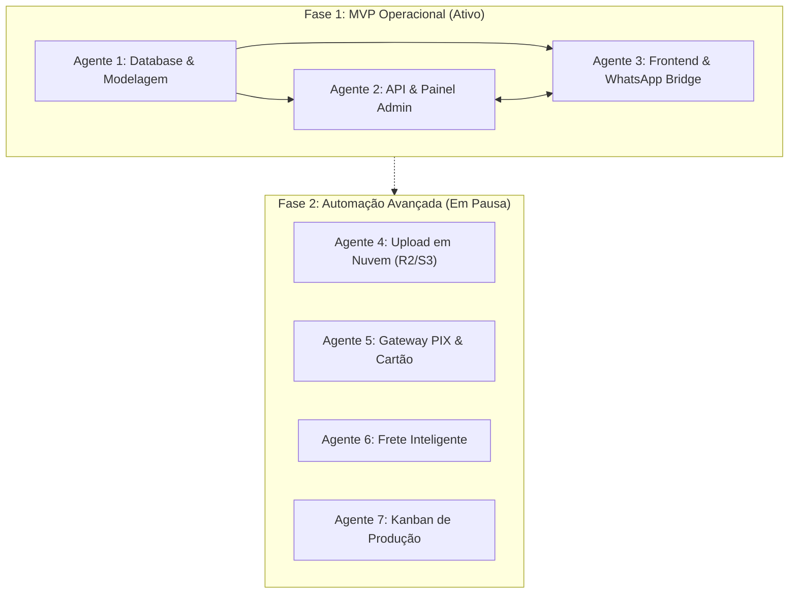

# 🗺️ Especificação Técnica & Roadmap de Execução: GráficaPRO (Web-to-Print)

> **Documento preparado para execução modular e orquestração por múltiplos agentes (Multi-Agent Architecture).**  
> **Versão:** 2.0  
> **Status:** MVP Focado em Operação Rápida (WhatsApp + Link de Arte) com Backlog Avançado Preservado.

---

## 1. Visão Geral do Sistema & Estratégia de Negócio

A plataforma **GráficaPRO** é um sistema de e-commerce web-to-print modular.  
Seu principal diferencial é a flexibilidade: o administrador pode lançar qualquer tipo de produto impresso (panfletos, tags, folders, catálogos, banners, adesivos) e compor para cada um deles quadros/blocos de atributos customizáveis (tamanho, papel/material, cores, lados, acabamentos, furos, dobras) com tabela de preços escalonada por tiragem.

### 🎯 Fluxo Operacional Atual (MVP Simplificado):
1. **Configuração pelo Cliente:** O cliente seleciona tamanho, papel, tiragem, acabamentos e visualiza o preço atualizado em tempo real.
2. **Envio da Arte:** O cliente insere o link de compartilhamento da arte (Google Drive, WeTransfer, Dropbox, OneDrive) ou opta por contratar criação de layout.
3. **Fechamento Ágil via WhatsApp:** Ao clicar em *"Finalizar no WhatsApp"*, o sistema gera automaticamente uma mensagem estruturada e abre a conversa com o WhatsApp comercial da gráfica já com todas as especificações técnicas, tiragem, valor orçado e link do arquivo.
4. **Acordo Comercial:** A gráfica valida a arte, combina pagamento e frete diretamente com o cliente.

---

## 2. Divisão de Trabalho para Múltiplos Agentes

Para permitir desenvolvimento paralelo e autônomo, o projeto é subdividido em missões claras para **4 agentes especializados**:



---

## 3. Módulos Ativos (Fase 1 - MVP Operacional)

### 🤖 AGENTE 1: Banco de Dados e Modelagem Relacional (Prisma + PostgreSQL)
**Objetivo:** Substituir os dados estáticos (`mockProducts.ts`) por um banco de dados relacional que suporte atributos 100% dinâmicos.

*   **Entregáveis:**
    1. Schema Prisma configurado com as tabelas:
       - `Product`: ID, nome, slug, descrição, categoria, imagem de capa, ativo (boolean), prazo de produção.
       - `AttributeGroup`: ID, título (ex: "Tamanho", "Material"), `displayType` (`size_grid`, `material_list`, `sides_cards`, `color_cards`, `finishing_cards`, `radio_cards`, `select_box`), ordem de exibição.
       - `AttributeOption`: ID, grupoId, label, subtítulo, badge (ex: "MAIS POPULAR"), modificador percentual ou fixo, ícone/metadados.
       - `ProductAttributeMapping`: Associação de quais grupos pertencem a quais produtos.
       - `PriceTierMatrix`: Tabela de tiragens e preços por combinação ou produto base (quantidade, preço unitário, preço total).
       - `StoreConfig`: Número de WhatsApp comercial da gráfica, mensagem padrão, chave PIX manual.
    2. Seed script (`prisma/seed.ts`) com os dados padrão do Panfleto/Flyer e Tags para teste imediato.

---

### 🤖 AGENTE 2: Painel Administrativo do Lojista (Admin Dashboard)
**Objetivo:** Interface protegida onde o dono da gráfica cadastra e altera produtos, blocos de atributos e tabelas de preços sem tocar em código.

*   **Entregáveis:**
    1. **Gerenciador de Produtos:**
       - Criar, editar e pausar produtos.
       - Upload de foto de capa e descrição.
    2. **Construtor Modular de Atributos:**
       - Criar novos quadros (ex: "Tipo de Dobra", "Corte Especial", "Cordão").
       - Escolher se o cliente verá botões/rádio ou select box.
       - Adicionar opções, escrever descrições e definir variações de preço.
       - Vincular blocos aos produtos desejados.
    3. **Editor de Tabela de Tiragens (Estilo Planilha):**
       - Grade para preenchimento ágil de quantidades (ex: 25, 50, 100, 250, 500, 1000, 2000, 4000...) e seus respectivos preços de venda.

---

### 🤖 AGENTE 3: Conexão da Vitrine & Gerador de Pedido WhatsApp
**Objetivo:** Ligar o configurador visual existente ao banco de dados e implementar o fluxo de Link do Drive + WhatsApp.

*   **Entregáveis:**
    1. **Integração Front-to-Back:**
       - O configurador passa a carregar dinamicamente os produtos e atributos salvos no banco pelo Agente 2.
    2. **Campo de Link de Arquivo (Google Drive / Dropbox / WeTransfer):**
       - Input no resumo do pedido para o cliente colar o link da arte compartilhada.
       - Validador simples de URL e instruções amigáveis ("Lembre-se de deixar o link como público/visível").
       - Opção para clientes que desejam contratar criação de layout.
    3. **WhatsApp Order Generator:**
       - Função de serialização que formata o pedido com Markdown do WhatsApp:
         ```text
         🖨️ *NOVO PEDIDO - GRÁFICA ONLINE*
         ----------------------------------
         📦 *Produto:* Panfletos e Flyers
         📏 *Tamanho:* 148 x 210 mm (A5)
         📄 *Material:* Couchê Brilho 150 g
         🔄 *Lados:* Frente e Verso (4x4)
         🎨 *Cores:* Colorido
         ✨ *Acabamento:* Sem acabamento
         ----------------------------------
         🔢 *Tiragem:* 4.000 unidades
         💵 *Valor Estimado:* R$ 806,60
         🔗 *Link da Arte:* https://drive.google.com/file/d/...
         ----------------------------------
         Olá! Configurei esse pedido pelo site e gostaria de finalizar o pagamento e prazo.
         ```
       - Botão que abre a URL `https://wa.me/55DDDNUMERO?text=...` em nova aba ou aplicativo.

---

## 4. Módulos em Pausa (Backlog Futuro Preservado)

As etapas a seguir estão totalmente mapeadas e serão acionadas na Fase 2 da expansão:

### ⏸️ BACKLOG A: Upload e Validação Direta em Nuvem (Cloud Storage)
*   **Serviço:** Cloudflare R2 ou Supabase Storage.
*   **Funcionalidades:**
    - Upload direto de arquivos de até 200MB (PDF/X-1a, CDR, AI, PSD).
    - Validador de sangria e formato de cor (CMYK).
    - Download em lote pelo painel administrativo para envio à CTP/impressora.

### ⏸️ BACKLOG B: Checkout Transacional & PIX Automático
*   **Gateways:** Mercado Pago, Asaas ou EFI (Gerencianet).
*   **Funcionalidades:**
    - Geração de QR Code PIX dinâmico com baixa e confirmação em tempo real via Webhook.
    - Parcelamento no cartão em até 12x.

### ⏸️ BACKLOG C: Cálculo de Frete Integrado
*   **APIs:** Melhor Envio / Frenet / Correios.
*   **Funcionalidades:**
    - Cálculo de peso volumétrico a partir da área do papel ($\text{largura} \times \text{altura} \times \text{gramatura} \times \text{tiragem}$).
    - Opções de Sedex, PAC, transportadoras e Retirada no Balcão Grátis.

### ⏸️ BACKLOG D: Esteira Kanban de Produção Gráfica
*   **Quadro de Produção:**
    - Status: $\text{Aguardando Pagamento} \rightarrow \text{Aguardando Arte} \rightarrow \text{Arte Aprovada} \rightarrow \text{Impressão} \rightarrow \text{Acabamento} \rightarrow \text{Pronto/Expedição}$.
    - Notificações automáticas ao cliente (E-mail / API WhatsApp Z-API ou Evolution API) a cada mudança de estágio.

---

## 5. Diretrizes para Agentes de IA Executores

Ao despachar tarefas para subagentes ou novos contextos de IA:
1. **Consistência de Stack:** Manter Next.js (App Router), TypeScript e Tailwind CSS.
2. **Modularidade Rigorosa:** Nenhum atributo de produto deve ser "hardcoded"; todos devem vir do motor de atributos dinâmicos (`AttributeGroup` e `AttributeOption`).
3. **Independência:** O Agente 3 pode ser testado utilizando as variáveis de ambiente locais antes mesmo do Agente 2 estar 100% finalizado.
